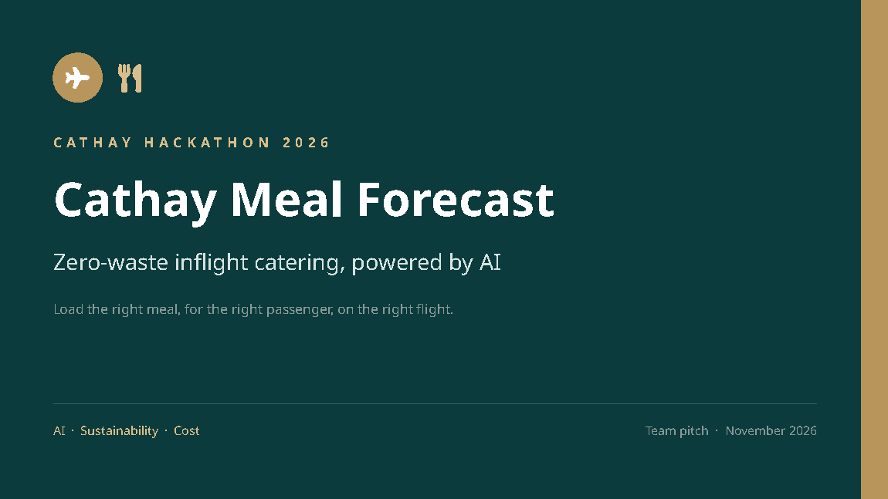

# Cathay Meal Forecast · Zero-Waste Inflight Catering

> **Cathay Hackathon 2026 concept.** AI meal forecasting and passenger pre-orders that load the right meal, for the right passenger, on the right flight. The goal is less food waste and lower catering cost, with no drop in service.

**[Live demo](https://shentonyan.github.io/cathay-meal-forecast/)** · **[Poster](https://shentonyan.github.io/cathay-meal-forecast/poster.html)** · **[Research report](https://shentonyan.github.io/cathay-meal-forecast/research.html)** · **[Pitch deck (PPTX)](pitch/cathay_meal_forecast_pitch.pptx)**



---

## The problem

| Metric | Value | Source |
|---|---|---|
| Cabin waste per passenger | 0.94 kg (3.6 M tonnes in 2023) | [IATA Sustainable Cabin](https://www.iata.org/policy/environment/pages/cabin-waste.aspx) |
| Share that is untouched food and drink | 34% | [IATA Cabin Waste Fact Sheet](https://www.iata.org/en/iata-repository/pressroom/fact-sheets/fact-sheet-cabin-waste/) |
| Value incinerated or landfilled each year | ~US$6 B | [IATA Cabin Waste Fact Sheet](https://www.iata.org/en/iata-repository/pressroom/fact-sheets/fact-sheet-cabin-waste/) |

International catering waste is classed as a Category 1 animal by-product, so it must be incinerated or deep-buried rather than recycled ([EU Reg. 1069/2009](https://www-int.iata.org/contentassets/821b593dd8cd4f4aa33b63ab9e35368b/joint-statement-towards-smarter-regulation.pdf), [GOV.UK](https://www.gov.uk/guidance/handling-and-disposing-of-international-catering-waste)). The only practical lever is **source reduction**: forecast first, then load less.

Forecasting is proven to work. KLM's AI no-show forecast cut food waste by **63%** compared with catering for every booked passenger ([Onboard Hospitality](https://www.onboardhospitality.com/klm-combats-food-waste-with-ai/)). Cathay already uses its *Choose My Meal* data to adjust catering, but only for First and Business ([Cathay Pacific](https://flights.cathaypacific.com/en_US/flying-with-us/inflight-dining/choose-my-meal.html)).

## The solution: three layers, one loop

| # | Layer | What it does |
|---|---|---|
| 1 | **Pre-order for every cabin** | Choose My Meal opens to Economy. +50 Asia Miles to pre-order, +150 to skip the meal, and the passenger sees the CO₂ saved. |
| 2 | **Forecast per flight, per dish** | Gradient boosting (LightGBM/XGBoost) predicts no-shows and dish shares from route, departure time, season, load factor and passenger mix. Pre-orders count as certain demand. |
| 3 | **Optimise the load** | A newsvendor rule sets quantities at a chosen service level, so nobody goes without a meal and first-choice availability stays high. |

Returned trays and actual consumption feed back into the model after every flight.

### How the loading rule works

The optimal load `Q*` is the demand quantile at the critical ratio:

```
P(D ≤ Q*) = Cu / (Cu + Co)        Cu = cost of running out, Co = cost of over-catering
```

In the demo, pre-orders are loaded exactly. The remaining (open) demand is modelled per dish as `N(μ, σ)`, where σ combines multinomial choice noise, ±8% model error on dish shares and no-show variance. The total meal count is set at the chosen service level, and the stock is then split across dishes so that every dish has the same stock-out risk. A Monte Carlo of 1,000 flights (binomial no-shows plus share errors) compares this rule against the legacy rule: *100% of bookings × fixed network ratio + 5% buffer*.

## Demo walkthrough

The live demo is one self-contained HTML file ([`docs/index.html`](docs/index.html)) that runs entirely in the browser.

1. **Passenger app.** An Economy passenger on CX 251 HKG→LHR pre-orders a dish or skips the meal and earns Asia Miles. Every choice updates the forecast live.
2. **Flight forecast.** Pick a flight, cabin and service level, then press *Simulate 1,000 flights* to compare the AI load with the legacy rule. A chart shows the waste-versus-service trade-off.
3. **Impact dashboard.** The results scale to the whole network. Cost and sustainability KPIs update as you move the sliders (passengers, waste baseline, reduction, uptake, meal cost, meal weight, block time, fuel price).

## Results (synthetic data, illustrative)

**Flight-level simulation**: CX 251 Economy, 241 booked, 95% service level

| Metric | Legacy rule | AI + pre-order |
|---|---|---|
| Meals loaded | 255 | 237 |
| Meals wasted per flight | 26.8 | 8.8 (**−67%**) |
| First-choice availability | 96.1% | 97.4% |

The AI loads fewer meals in total, but more of the dish passengers actually choose (chicken 102 → 111, beef 102 → 75). That is why waste falls while service improves.

**Network base case** (annual)

| Cost | | Sustainability | |
|---|---|---|---|
| Meal production avoided | US$20.3 M | Food waste avoided | 1,695 t |
| Fuel (lighter aircraft) | US$0.3 M | Meals not thrown away | 3.39 M |
| Incineration fees avoided | US$0.4 M | Jet fuel saved | 381 t |
| Asia Miles incentives | −US$1.1 M | CO₂ from fuel | 1,205 t |
| Platform running cost | −US$1.5 M | CO₂e embodied in food | 4,237 t |
| **Net savings** | **US$18.4 M** | **Total CO₂e avoided** | **5,442 t** |

Assumptions: 25 M full-service passengers a year; 0.17 kg of untouched food per passenger (IATA ratios: 0.94 kg × 18%); 35% AI reduction (deliberately below the 67% simulated and KLM's 63%) plus 15% pre-order uptake; US$6 and 0.5 kg per meal; 5 h average block time; ~30 kg fuel per extra tonne per flight hour (IATA); 3.16 kg CO₂ per kg of fuel; 2.5 kg CO₂e embodied per kg of food. Every input is a slider in the dashboard.

## Repository structure

```
cathay-meal-forecast/
├── README.md
├── docs/                         ← GitHub Pages site (publish from /docs)
│   ├── index.html                   live demo (single file, all data inline)
│   ├── poster.html                  A4 poster (print with Ctrl+P, A4, no margins, background graphics on)
│   ├── research.html                full research report with 37 cited sources
│   ├── assets/
│   │   ├── meal-tray.png            poster illustration
│   │   └── demo-qr-plain.png        QR code used by the poster and the deck
│   └── .nojekyll
├── pitch/
│   ├── cathay_meal_forecast_pitch.pptx   9-slide pitch deck (English)
│   ├── speaker-notes.md                  slide-by-slide script, about 3 minutes
│   └── slides/slide-01…09.png            slide previews
├── research/
│   ├── references.json              structured citation list for the report
│   ├── figures/                     charts used in the report
│   └── notes/                       research notes, one per track (hover links for source quotes)
│       ├── 01_academic_literature.md
│       ├── 02_industry_benchmarks.md
│       ├── 03_cathay_current_state.md
│       └── 04_modelling_and_demo_design.md
├── src/
│   ├── pitch-deck/                  pptxgenjs script that rebuilds the deck
│   │   ├── build_deck.js
│   │   └── package.json
│   └── qr/make_qr.py                dependency-light QR generator (Pillow only)
└── media/
    └── demo-qr.png                  branded QR card for printing or sharing
```

## Run and deploy

**View locally.** Open `docs/index.html` in any modern browser. Charts load Highcharts from the jsDelivr CDN, so an internet connection is needed.

**Publish with GitHub Pages**
1. Push this repository to GitHub.
2. Go to **Settings → Pages → Build and deployment → Deploy from a branch**, then choose branch `main` and folder **`/docs`**.
3. The site is served at `https://<user>.github.io/<repo>/`. The poster and report sit at `/poster.html` and `/research.html`.

**Regenerate the QR code** (needed if the Pages URL changes)
```bash
pip install pillow
python src/qr/make_qr.py https://<user>.github.io/<repo>/
node src/pitch-deck/build_deck.js     # optional: put the new QR into the deck
```

**Rebuild the pitch deck**
```bash
cd src/pitch-deck && npm install && cd ../..
node src/pitch-deck/build_deck.js     # writes pitch/cathay_meal_forecast_pitch.pptx
```

## Research basis

The full report is in [`docs/research.html`](docs/research.html). The notes from each research track are in [`research/notes/`](research/notes/): [academic literature](research/notes/01_academic_literature.md), [industry benchmarks](research/notes/02_industry_benchmarks.md), [Cathay today](research/notes/03_cathay_current_state.md), and [modelling and demo design](research/notes/04_modelling_and_demo_design.md). Key sources:

- **Academic:** Aghazadeh (2025), ML-based inflight food waste prediction ([DergiPark](https://dergipark.org.tr/en/download/article-file/4159755)); Kumawat, Giertzsch & God (2025), synthetic data for on-board consumption prediction ([DGLR](https://www.dglr.de/publikationen/2025/650481.pdf)); You, Bhamra & Lilley (2020), passenger food-wasting behaviour ([MDPI Sustainability](https://www.mdpi.com/2071-1050/12/20/8571/html)); Goto et al., MDP model for airline meal provisioning ([ResearchGate](https://www.researchgate.net/publication/2407094_Coffee_Tea_or_A_Markov_Decision_Process_Model_for_Airline_Meal_Provisioning)).
- **Industry:** IATA cabin waste audits; KLM TRAYS ([AviationA2Z](https://aviationa2z.com/index.php/2024/02/06/klm-using-artificial-intelligence-to-reduce-food-waste/)); Airbus Smart Catering ([Aeronautics Magazine](https://aeronauticsmagazine.com/featured/airlines-could-save-millions-per-year-by-letting-ai-decide-how-much-food-to-load-airbus-says)); Winnow ([winnowsolutions.com](https://www.winnowsolutions.com/)).
- **Cathay Pacific:** Choose My Meal; Cathay Dining waste segregation (2025); Feeding Hong Kong partnership; 2025 traffic figures.

**Gap this project fills:** published models are mostly trained on synthetic data. None of them combines pre-order signals, per-dish forecasting and an explicit loading-optimisation rule.

## Limitations

- All flights, bookings, dish shares and costs in the demo are **synthetic or assumed**. A real pilot would use Cathay's load and return data.
- Asia Miles incentive uplift is a hypothesis to A/B test, not a measured result.
- Cabin-level meal costs, Cathay's food-waste tonnage and fleet details were not available from public sources.

## Disclaimer

This is an independent hackathon concept. It is **not** an official Cathay Pacific product and is not endorsed by Cathay Pacific. Brand names are used only to describe the context.

## Author

**Shenton Yan**, Cathay Hackathon 2026.
