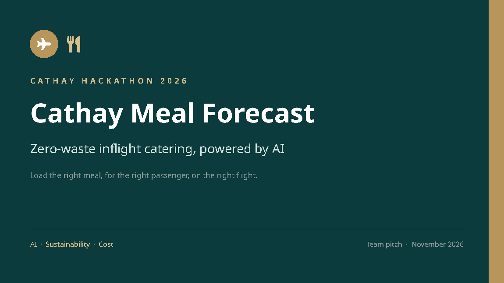
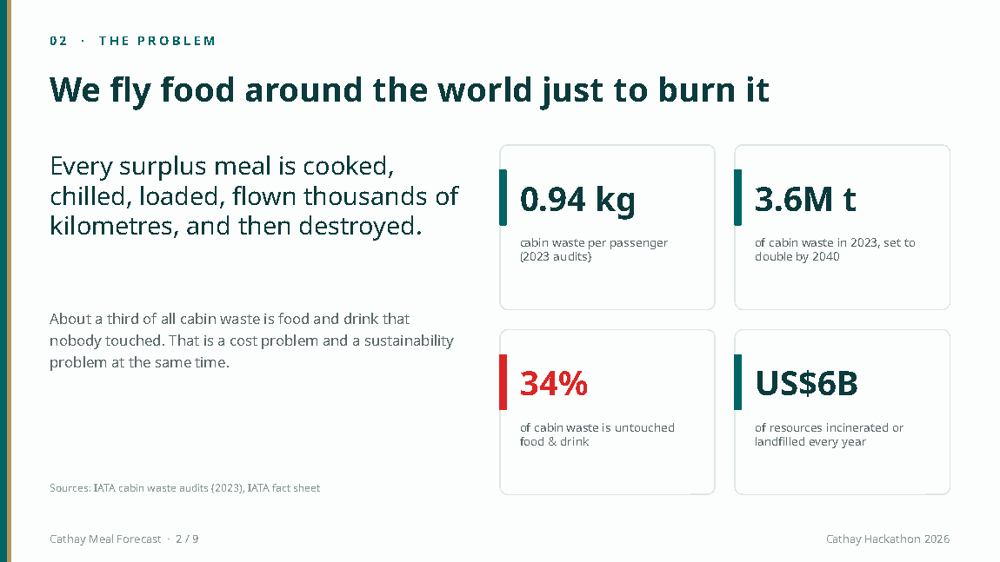
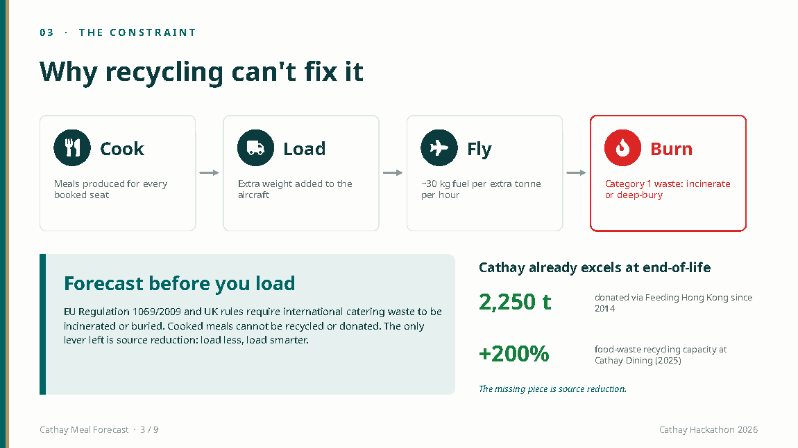
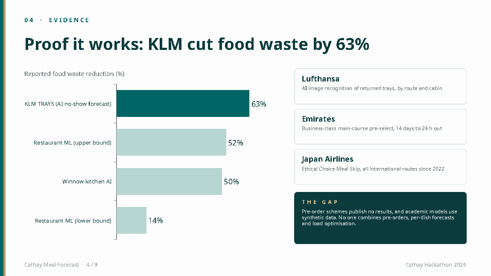
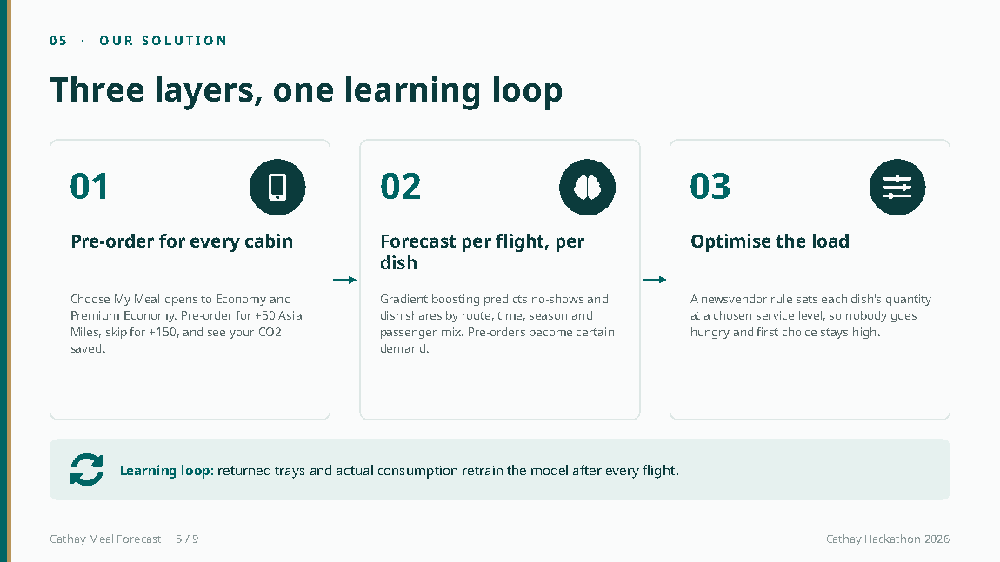
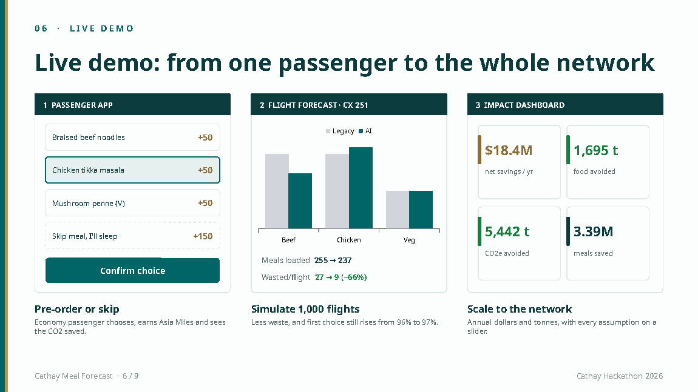
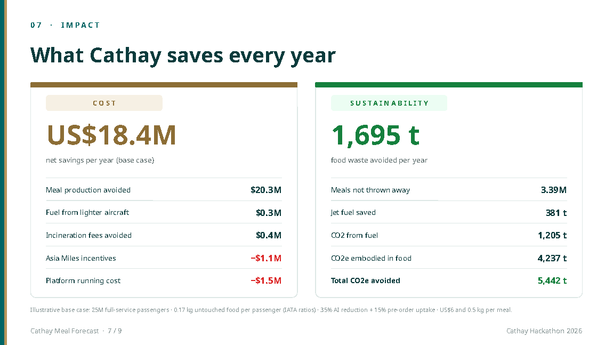
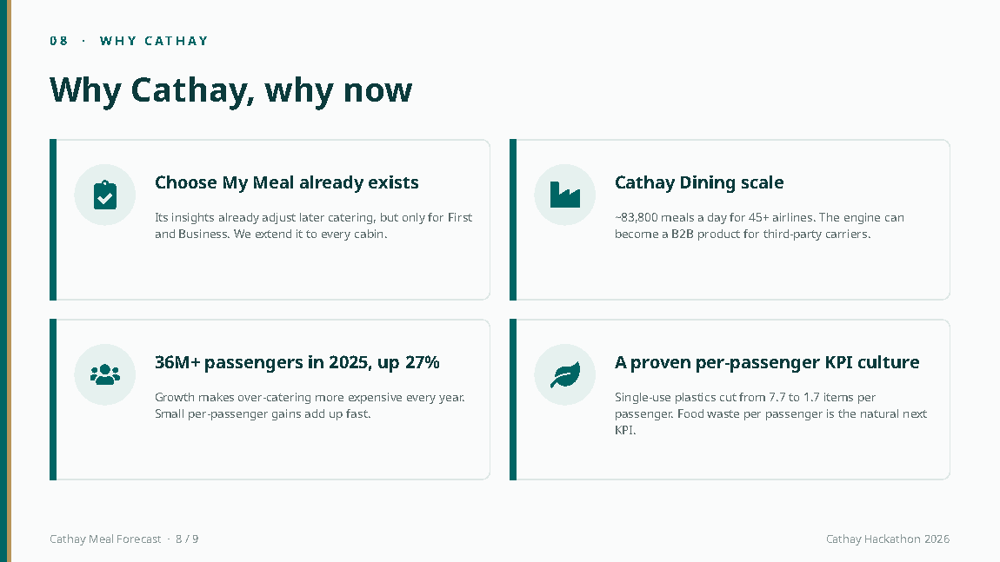
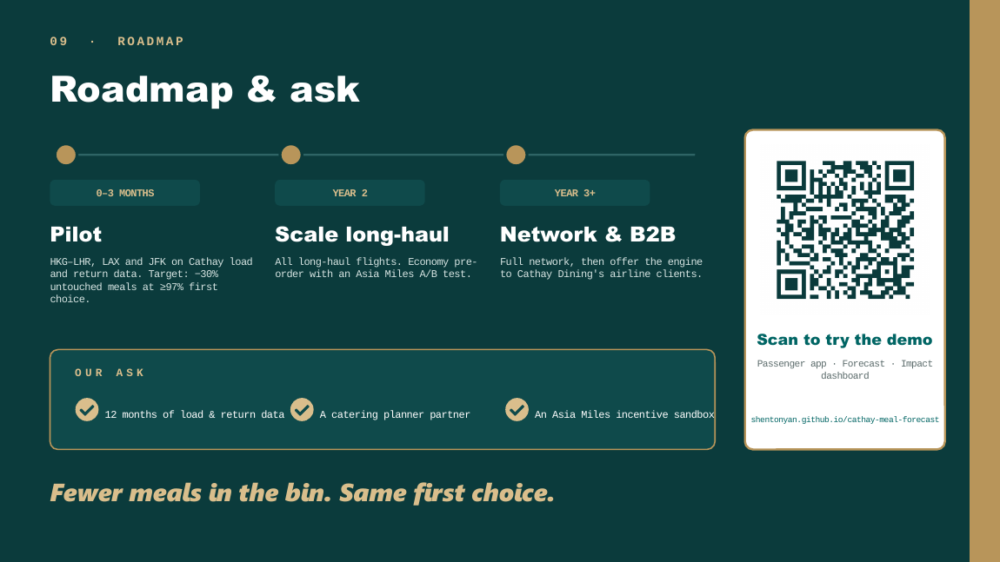

# Speaker notes — Cathay Meal Forecast pitch

Target length: about 3 minutes. Switch to the live demo at slide 6.

## Slide 1 · Cover

Hi, we are the Meal Forecast team. Our idea: use AI and pre-orders so Cathay loads the right meal for the right passenger on the right flight, cutting food waste and cost at the same time.

## Slide 2 · The problem

IATA audits show 0.94 kg of cabin waste per passenger, 3.6 million tonnes in 2023. Up to 34% is food and drink nobody touched, worth around 6 billion US dollars a year.

## Slide 3 · Why recycling can't fix it

Regulation is the twist: cooked international catering waste is a Category 1 by-product and must be burned or buried. Cathay already does great work at the end of life. What is missing is not loading the surplus in the first place.

## Slide 4 · Proof it works

KLM already proved the concept: forecasting how many passengers actually board cut food waste 63%, about 111 tonnes a year. Others run pre-order or skip-meal options but publish no results. Research models mostly use synthetic data. Nobody has put pre-orders, per-dish forecasting and load optimisation together. That is our gap.

## Slide 5 · Our solution

Three layers. One: open pre-ordering to every cabin and reward it with Asia Miles, including a bigger reward for skipping a meal. Two: a gradient boosting model forecasts no-shows and dish shares, with pre-orders treated as certain demand. Three: a newsvendor rule converts that forecast into a load plan at a chosen service level. Actual consumption feeds back into the model.

## Slide 6 · Live demo

Switch to the live demo now. Screen 1: an Economy passenger on CX 251 to London pre-orders or skips and earns miles. Screen 2: the forecast for that flight. Simulating 1,000 flights, we load 237 meals instead of 255, waste falls from 27 to 9 meals per flight, and first-choice availability actually goes up. Screen 3: the network dashboard, where judges can move any assumption.

## Slide 7 · Impact

Two outcomes in one system. Cost: about 18 million US dollars net per year, mainly from meals we no longer produce, after paying for miles and the platform. Sustainability: about 1,700 tonnes of food and 5,400 tonnes of CO2e avoided every year. These are illustrative numbers using IATA ratios. With Cathay data, every assumption gets replaced.

## Slide 8 · Why Cathay, why now

Why Cathay specifically: the pre-order platform already exists, Cathay Dining gives us scale and a B2B route, passenger numbers are growing fast, and Cathay has already shown it can hit per-passenger cabin targets with plastics.

## Slide 9 · Roadmap & ask

We want to start small: a three-month pilot on three HKG long-haul routes using real load and return data, targeting 30% fewer untouched meals. Then all long-haul with Economy pre-ordering, then the full network and Cathay Dining clients. Our ask is data access, a catering planner to work with, and an Asia Miles sandbox. Scan the QR code to try the demo yourself. Fewer meals in the bin, same first choice. Thank you.
